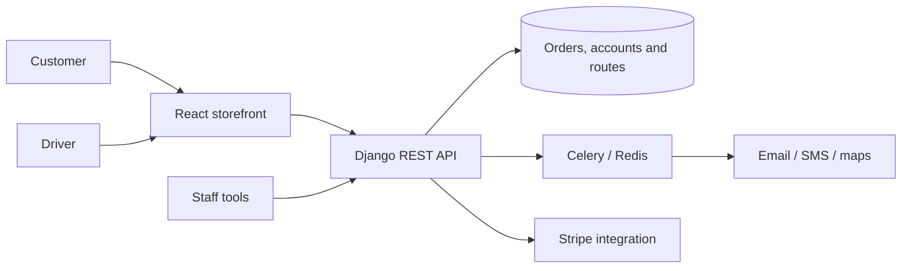

# MilkRoute

**From an order to a delivery route.**

A React and Django commerce/logistics application with customer accounts, checkout,
regional delivery planning and driver operations. **MilkRoute** is the public
portfolio identity; the repository URL remains `MilkVancouver` for existing links.
Historical source assets retain their original Vancouver Milk Co./VanMilk identity
and rights. The application evolved from [MeatDirect](https://github.com/rcc00n/MeatDirect).

## Review the engineering

1. [Follow the routing case](docs/ENGINEERING_CASE_STUDY.md): paid orders become
   ordered stops, an optional routing provider proposes a sequence, and drivers
   record delivery state.
2. [Inspect the deterministic routing regressions](backend/delivery/tests/test_google_route_optimization.py):
   a synthetic four-stop route, provider reordering and fallback behavior.
3. [Run the isolated PostgreSQL suite](ci/README.md#postgresql-business-regressions):
   route generation, driver permissions/proof of delivery, checkout and account
   contracts. External providers are mocked; no real store or customer data is needed.

[Capabilities](#capabilities) · [Architecture](#architecture) ·
[Run locally](#run-locally) · [Development guide](docs/DEVELOPMENT.md)

## Capabilities

- **Storefront:** API-backed products and categories, product details, a persistent
  browser cart, checkout and customer account screens.
- **Accounts:** session authentication, profile and region data, email/phone
  verification and password-reset workflows.
- **Orders and payments:** order records, Stripe checkout configuration and
  webhook handling, with existing regression tests for checkout boundaries.
- **Delivery operations:** regional delivery days, route generation, driver
  assignment, upcoming routes and proof-of-delivery actions.
- **Administration and content:** Django admin and staff APIs for operational
  workflows, plus product, blog and contact content.
- **Background processing:** Celery tasks for notifications, cleanup and logistics;
  optional external mapping, email, SMS and media-storage integrations.

Payments, messaging, media storage and route optimization require separately
configured development providers. Product requests expose explicit loading/error
states; a fresh database starts with an empty catalogue.

## Architecture



| Layer | Stack |
| --- | --- |
| Frontend | React 18 · TypeScript · Vite 5 · Tailwind CSS · Radix UI |
| Backend | Python · Django · Django REST Framework · drf-spectacular |
| Data and jobs | SQLite locally; PostgreSQL via `DATABASE_URL` · Celery · Redis |
| Integrations | Stripe · SendGrid · Twilio · optional S3 media and Google route optimization |

## Run locally

Start from a fresh checkout with Python and Node.js available. The
[development guide](docs/DEVELOPMENT.md) provides the backend environment and SQLite
setup. After starting Django on **127.0.0.1:8000**, run:

```bash
cd frontend
npm ci
npm run dev -- --host 127.0.0.1
```

Open **http://127.0.0.1:5173**. Vite proxies `/api` and `/health` to Django. Populate
local products through Django admin; empty source data remains empty. Account
verification and background notifications additionally need a configured worker
and broker.

```bash
npm run lint   # TypeScript checking
npm run build
```

## Source guide

| Area | Entry point |
| --- | --- |
| Storefront and driver routes | [`frontend/src/App.tsx`](frontend/src/App.tsx) |
| Products and availability | [`backend/products`](backend/products) |
| Identity and profiles | [`backend/accounts`](backend/accounts) |
| Orders and checkout | [`backend/orders`](backend/orders) · [`backend/payments`](backend/payments) |
| Delivery routes and tasks | [`backend/delivery`](backend/delivery) |
| Staff operations | [`backend/admin_api`](backend/admin_api) |
| API schema and docs | [`backend/shop/urls.py`](backend/shop/urls.py) — `/api/docs/swagger/` |

See the [development guide](docs/DEVELOPMENT.md) for process boundaries, local
commands and the existing test locations. Deployment settings and Compose files
require environment review; they are not a one-command public-hosting recipe.
No project-wide licence file is present, and this documentation adds no new licence.
