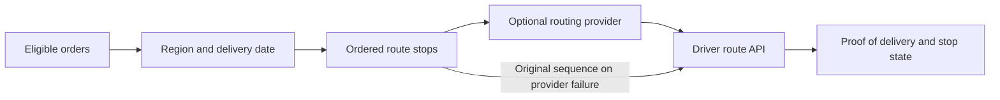

# MilkRoute: orders become operational routes

A delivery application needs more than a checkout success screen. Paid orders must
belong to the right region and day, become inspectable route stops, and expose
appropriate actions to assigned drivers. This case is grounded in the current
Django/React source; it does not claim measured distance savings or a proprietary
routing solver.

## Keep the business boundary explicit

[Order and region records](../backend/orders/models.py) hold the delivery scope.
[Route generation](../backend/delivery/tasks.py) creates operational routes;
[delivery models](../backend/delivery/models.py) preserve stop ordering and status.
The [generation regressions](../backend/delivery/tests/test_generate_delivery_routes.py)
exercise the date/region/order selection with synthetic records.

## Route integration, with an explicit fallback

[The routing adapter](../backend/delivery/google_routes.py) keeps the origin fixed
and requests an ordering of remaining stops. For the synthetic fixture in the
[regression test](../backend/delivery/tests/test_google_route_optimization.py):

| State | Stop sequence |
| --- | --- |
| Original fixture | A → B → C → D |
| Mock provider order `[2, 0, 1]` | A → D → B → C |
| Missing key or request failure | A → B → C → D |

These are labelled example stops, not actual customer addresses, an optimized map
or a measured improvement. The adapter delegates routing to Google; it does not
implement or prove a global optimum. It skips unsupported large routes and keeps
the original operational sequence when configuration or the provider is unavailable.
[Future-route tests](../backend/delivery/tests/test_google_route_optimization.py)
verify that incomplete future routes can be resequenced without changing completed
or past routes.

The tradeoff: a driver retains a usable ordered list during an integration outage,
but the list may not be geographically efficient. Provider availability and route
quality require their own deployment evidence.

## Driver state and checkout have separate contracts

[Driver API tests](../backend/delivery/tests/test_driver_routes_api.py) and
[proof-of-delivery tests](../backend/delivery/tests/test_driver_proof_of_delivery.py)
exercise assigned access and operational state transitions. [Checkout tests](../backend/payments/tests/test_checkout_api.py)
verify order/item totals and payment-intent metadata with a mocked payment client.
[Webhook tests](../backend/payments/tests/test_stripe_config_and_webhooks.py) cover
configuration and event handling. Creating an order, receiving provider confirmation
and completing a delivery are separate records and actions.

## Reproduce the evidence

Follow [the CI guide](../ci/README.md#postgresql-business-regressions). The scoped
business job runs PostgreSQL migrations and the existing Django test modules with
synthetic data, temporary media, in-memory email and blocked external sockets.
It needs no Google, Stripe, SMS or email credentials. Frontend TypeScript/build
checks remain a separate job. This is not a full all-module, live-provider or
production performance certification.

Source ownership, historical naming and project lineage remain intact. No real
store URL or customer dataset is needed to review this engineering case.
